# InferOps architecture and Hexagonal design

InferOps is one modular Python application. Its domain makes decisions, its
application services coordinate work, and adapters connect those services to
models, media, HTTP, databases and messaging. The standalone library and server
share these services.

Read the [documentation index](README.md), [full lifecycle](lifecycle.md),
[Redpanda guide](messaging.md) or [offline diagram gallery](architecture/index.html).
This page describes the current source; [redesign.md](redesign.md) records the
broader contracts and staged release migration.

## Why Hexagonal Architecture fits InferOps

The same use case must work when driven by a Python program, an uploaded video,
a browser camera or a broker worker. It also needs different model backends and
storage implementations. Ports and adapters keep those technology choices at the
application boundary. Tests can use fake models and an in-memory repository;
production supplies ONNX Runtime, PostgreSQL and MinIO. This follows
[Cockburn's original architecture description](https://alistair.cockburn.us/hexagonal-architecture).

The hexagon represents the inside/outside boundary. It does not prescribe six
services, six directories or a deployed process for every component. InferOps
uses a domain/application split inside that boundary to separate calculation
from orchestration.



### The four responsibilities

| Part | What belongs here | InferOps example |
| --- | --- | --- |
| Domain | Types, algorithms and policy decisions without infrastructure access | IoU/Kalman tracking, fusion windows, severity, dedupe and cooldown |
| Application | Use cases, ordering, ownership and calls through ports | Process a frame, accept incidents transactionally, finalize/retry evidence |
| Port | An application-facing contract for an external capability | `Repository.accept`, `ObjectStore.verify`, `InferenceBackend.infer` |
| Adapter | A translation between that contract and a technology | SQLAlchemy/asyncpg, boto3/MinIO, aiokafka, ONNX Runtime, FastAPI |

An **inbound adapter** drives a use case: FastAPI translates a request into an
`Engine` or processing-session call. An **outbound adapter** is called by the
application: `SqlRepository` implements the persistence contract. The Python
facade is a stable entry boundary; HTTP uses the same inference services.

### Dependency direction and execution direction

```text
Allowed source imports:
  domain      → domain
  ports       → domain, ports
  application → domain, ports, application
  adapters    → inner contracts and concrete integration dependencies
  bootstrap   → the components it constructs

Runtime calls:
  HTTP adapter → session service → Repository port → SQL adapter → PostgreSQL
```

The application calls an injected object through a port; bootstrap constructs
the concrete object. Protocols allow adapters to satisfy a contract without
inheriting a concrete application class. Ordinary internal helpers do not each
need an interface.

[Boundary tests](../tests/test_hexagonal_boundaries.py) check inward imports and
the package layout in CI. Importing `inferops` creates no clients, activates no
project and reads no deployment configuration. Settings are read when the
server is explicitly constructed.

## Repository structure and source map



```text
inferops/
  __init__.py, public.py        Stable Python exports and facade
  bootstrap.py                 Construction and resource wiring
  domain/                      Models, frames, tracking, fusion, incident/evidence policy
  application/                 Projects, model pool, sessions, execution, incidents,
                               evidence, jobs and delivery
  ports/                       Contracts for external capabilities and extensions
  adapters/inbound/            HTTP/WebSocket, CLI, source and broker workers
  adapters/outbound/           Runtimes, stages, media/spool, SQL, objects,
                               messaging, projects and observability
  sdk/                         Remote HTTP client
  testing/                     Fakes, fixtures and tiny model generation
projects/                      Product-specific definitions, plugins and weights
configs/                       Platform defaults
deploy/                        Images, Compose overlays and monitoring configuration
tests/                         Policy, boundary, adapter, integration and recovery checks
scripts/                       Development, verification and operations wrappers
docs/                          Explanations, contracts and architecture drawings
```

The repository root and importable `inferops/` package are distinct. Generated
`.venv/`, `.run/`, wheel metadata and project weights have their own roles; see
[generated files](../README.md#generated-files-and-cleanup). The detailed
[package guide](structure.md) and [file inventory](architecture/repository-tree.md)
show individual modules.

| Use case | Application implementation | Collaborator |
| --- | --- | --- |
| Load a project and pin a revision | [projects.py](../inferops/application/projects.py) | [ProjectLoader](../inferops/adapters/outbound/projects/loader.py), `ProjectDefinition` |
| Share and close inference backends | [models.py](../inferops/application/models.py) | Backend port and ONNX Runtime, TensorRT EP or Triton |
| Open, process and close isolated sessions | [sessions.py](../inferops/application/sessions.py) | [engine.py](../inferops/application/engine.py), HTTP and source adapters |
| Execute stages and model groups | [execution.py](../inferops/application/execution.py) | Stage factory, domain algorithms and project extensions |
| Accept incidents and request effects | [incidents.py](../inferops/application/incidents.py) | Incident policy; one `Repository.accept` transaction |
| Capture, save, recover and delete evidence | [evidence.py](../inferops/application/evidence.py) | Spool, encoder and object-storage ports |
| Admit, cancel and retry jobs | [jobs.py](../inferops/application/jobs.py) | Durable job records and shared `Engine.run` |
| Relay committed messages | [delivery.py](../inferops/application/delivery.py) | SQL outbox and server delivery adapter |

## Ports and their concrete adapters

| Port module | Contract | Current adapters / collaborators |
| --- | --- | --- |
| [inference.py](../inferops/ports/inference.py) | Backend load, tensors and close | `outbound/inference/`: ONNX Runtime, TensorRT EP, Triton; synthetic testing backend |
| [projects.py](../inferops/ports/projects.py) | Project loading, pinned definition and scoped plugins | `outbound/projects/`: YAML, manifests, artifacts and installed project packages |
| [extensions.py](../inferops/ports/extensions.py) | Pre/postprocessing, stages and alert extensions | Built-in stages/model plugins and `projects/<name>/` implementations |
| [persistence.py](../inferops/ports/persistence.py) | Sessions, atomic acceptance, evidence, inbox/outbox and jobs | `SqlRepository` with PostgreSQL or SQLite; `MemoryRepository` |
| [media.py](../inferops/ports/media.py) | Snapshot/clip encoding and durable spool | OpenCV/FFmpeg encoder and `CrashSafeSpool` |
| [storage.py](../inferops/ports/storage.py) | Put/read/verify/delete artifacts | S3-compatible MinIO adapter; filesystem adapter |
| [messaging.py](../inferops/ports/messaging.py) | Producer, consumer, transport and delivery | Redpanda/aiokafka, in-process transport and server delivery |

Incremental decoding lives in the inbound source adapter. Encoding and spooling
implement outbound media capabilities. Filesystem evidence storage and the
persistent capture spool are separate: production needs the spool even when
completed artifacts go to MinIO.

## Ownership and state

| Owner | State/resources it owns | Lifetime |
| --- | --- | --- |
| Project definition | Models, pipeline/rule definitions, plugin context and revision | Pinned per session; reload creates a new revision |
| Engine | Model pool, session registry, repository, evidence, delivery and transport | Explicit construction through close |
| Model pool | Loaded backends and bounded model concurrency | Shared within an engine/revision; retired after its sessions finish |
| Processing session | Generated ID/capability, tracking, fusion, cooldowns, stages, timeline and bounded reply cache | One run or explicit continued session |
| Evidence service | Bounded look-behind rings, active captures and encoding tasks | Engine lifetime; committed material survives in spool/SQL/MinIO |
| PostgreSQL | Durable ownership/lifecycle, records, job inputs, evidence and delivery progress | Across process restarts |

External stream names can repeat. Internal session IDs scope temporal state and
evidence. HTTP continuation requires the generated handle and
`X-Session-Capability`; a stream name or ID alone grants no continuation.
One-shot requests intentionally do not share temporal state.

The deployment assumes **one active application owner process per database/spool
bundle**, serving many sessions. Startup interrupts previous process owners.
Launching another default API/worker owner against that bundle can fence the
first owner's sessions. Separate worker entry points exist, but Compose does
not launch them. Multi-owner scheduling and cross-host session migration are
outside this deployment model.

## Processing and side effects

```text
Input adapter → session lock and timeline policy
  → shared model resources → session-owned tracking/fusion/incident decisions
  → atomic persistence of accepted effects
      ├─ evidence request → durable capture → encode → verify MinIO → status commit
      └─ outbox → broker / configured delivery targets → acknowledgment
```

Stages run in declaration order. Only a declared independent `model_group`
runs models concurrently; results merge in declaration order. Frame processing
stays serialized per session. Fusion and incident policy perform no SQL, S3 or
broker calls. Durable sinks become transactional records rather than side
effects inside those calculations.

File input decodes incrementally with backpressure. Live input observes frames
for evidence, then keeps at most one pending inference frame and reports
replacements. Capture has separate sampling/memory/disk limits: observing a
frame does not guarantee every camera frame is retained. The
[lifecycle guide](lifecycle.md) follows processing and its failure boundaries.

## Default services and authority



| Component | Role and authority | Default host endpoint |
| --- | --- | --- |
| API | Shared engine, UI, HTTP/WebSocket adapters and in-process background services | 8080 |
| PostgreSQL | Authoritative sessions, jobs, events, incidents, evidence, inbox/outbox and scheduling | 5432 |
| MinIO | Durable snapshots, clips and artifact manifests | 9000; console 9001 |
| Persistent spool | Recoverable capture/artifact material and retained incomplete captures | `/var/lib/inferops/spool` inside the API container |
| Redpanda | Durable Kafka-compatible event transport and optional broker input/output | Host 19092; container `redpanda:9092` |
| Redis | Reserved for rebuildable TTL/cache integrations; the current shared engine does not use it for frame/evidence state | 6379 |
| Prometheus | Application and infrastructure measurements | 9090 |
| Grafana | Provisioned views of those measurements | 3000 |
| Triton | Optional model server for `triton`/`deepstream` modes | HTTP 8000, gRPC 8001, metrics 8002 |

SQLite, memory and filesystem are explicit local/test choices. Standalone
prediction requires none of these services. Python callers can inject production
persistence/storage for server-equivalent durability. The shared engine uses
incremental PyAV decoding in all modes; installing a DeepStream extra does not
automatically replace that path.

## How to extend the system

| Change | Place it here | Check |
| --- | --- | --- |
| Add a product signal or face/pose calculation | Project plugin and fusion configuration | Project algorithm and pipeline tests |
| Add a pure tracking/policy algorithm | `domain/` | Deterministic tests without infrastructure |
| Add or change a use case | `application/`, through existing ports where possible | Use-case tests with injected fakes |
| Add an inference runtime | Outbound implementation of `InferenceBackend` | Backend contract and representative real model |
| Add an object store | Outbound implementation of `ObjectStore` | Checksums, deterministic keys, retry and deletion |
| Add an HTTP/CLI/broker entry | Inbound adapter calling shared services | Parity, ownership, input validation and errors |

[Adapter authoring](adapters.md) provides concrete examples. Keep clients and
filesystem operations at the edges and wire them in bootstrap. An integration
does not require another application runner or global active project.

## Verification and current limits

[CI](../.github/workflows/ci.yaml) runs boundaries, lint and main tests on Python
3.10 and 3.12. Infrastructure checks need their explicit service environment;
skips do not prove integration success. The [verification record](cleanup-verification.md)
documents real CPU/CUDA runs, playback, crash recovery and release rollback.

Live capacity still needs capture-enabled benchmarks measuring reply p50/p95/p99,
drops, evidence completion, memory, spool growth and outbox lag on fixed
hardware/media. Defaults remain provisional. Arbitrary DAGs, cross-host migration
and temporal-state reconstruction after restart are deferred. Rollback uses a
designated compatible release and preserves expanded records, object URIs and
volumes; see [release lifecycle](lifecycle.md#upgrade-and-rollback).
