# Full InferOps application lifecycle

This guide follows the checked-in system from installing a project to closing
its resources. Read [architecture](architecture.md) for the boundaries and
[messaging](messaging.md) for the database/broker protocol.



## Choose an entry point

| Entry | Work it performs | State and persistence |
| --- | --- | --- |
| `Model.predict` / `Model.infer` | A single model; image transforms or raw tensors | Model resources only; no tracking, fusion, incidents or evidence |
| `InferenceSession.predict` | A collection of model handles using a shared pool | Model resources; not a temporal pipeline session |
| `Engine.predict` | Direct model prediction from an engine's project | Shared model pool; bypasses pipeline decisions |
| `Engine.run` | Decode and process a complete image/video/source | Opens and closes a generated processing session; accumulates a summary |
| `Engine.open_session` + `process` | Explicit frame-by-frame pipeline continuation | Session owns tracking, fusion, cooldowns and timeline |
| HTTP image/upload/run | Translate requests into the same engine/session services | One-shot by default; explicit capability for continued image sessions |
| Browser WebSocket / camera stream | Bounded live frame input into session services | Distinct session per connection/run; latest-frame inference policy |
| Job API | Persist and execute queued complete-source work | Durable job input/status; one processing session per run |
| CLI / source / topic worker | Drive the same application services | Explicit engine lifecycle; broker input also uses transactional inbox |

The public facade is [public.py](../inferops/public.py). The standalone default
uses memory persistence and disables evidence. Durable library execution requires
explicit SQL repository, object store and persistent spool configuration; the
[Python guide](python-library.md) shows these choices. Server bootstrap enables
evidence by default.

## 1. Install, select and prepare a project

A project pack contains `project.yaml`, model definitions, project plugins,
pipelines, fusion rules and incident policies. Weights live separately under
that project's `model_repository/`; they are not embedded in the engine wheel.
See [project configuration](project-blocks.md).

For local CPU execution from this repository:

```bash
python -m pip install -e '.[cpu,video,artifacts]'
python -m pip install -e projects/driver_behaviour
inferops project prepare --domain-root projects/driver_behaviour
inferops validate --domain-root projects/driver_behaviour
```

Preparation resolves configured artifact sources, downloads/converts required
weights and validates model tensors/artifacts. A missing or invalid artifact is
an error, not a request to substitute a synthetic model. Runtime extras install
Python dependencies; external runtimes and model servers have separate
prerequisites. See [installation](python-library.md#installation).

For the full server, select the project/runtime in `.env`, then use the root
Compose entry point; see [deployment](../deploy/README.md).

## 2. Build the server and gate container startup

The root `compose.yaml` includes the base stack and one runtime overlay. The API
image packages engine code and UI; `/project` is a writable bind mount containing
the selected project. The `prepare` container validates/prepares that mount.

Services can start concurrently where dependencies permit. The API waits for
successful preparation and MinIO readiness, plus healthy PostgreSQL, Redis and
Redpanda. Triton modes also wait for the model server, which itself depends on
preparation. This is a **startup dependency graph**; it does not restart the API
whenever a dependency later becomes unhealthy.

Source: [base stack](../deploy/compose.yaml), [runtime overlays](../deploy/compose/)
and [API image](../deploy/docker/api.Dockerfile).

## 3. Construct the application explicitly

FastAPI lifespan calls `build_server_engine` in [bootstrap.py](../inferops/bootstrap.py).
Construction reads deployment settings and loads an instance-scoped project:

1. Load platform/project/model/pipeline/rule definitions and validate references.
2. Compute a project revision and bind relative plugins to that project context.
3. Construct the model pool, SQL repository, S3 storage, persistent spool,
   evidence service, delivery adapter and selected transport.
4. Inject those objects into `PipelineApplication` and wrap it in `Engine`.

Construction and startup are distinct. Constructors establish ownership;
`Engine.start()` starts resources. Importing the package performs neither step.
`Engine.from_project(...)` uses this same boundary with explicit local options.

## 4. Start and reconcile before serving

[Application startup](../inferops/application/engine.py) proceeds as follows:

1. Start the repository; create missing additive schema tables and record the
   schema version.
2. In server mode, mark previous live session owners interrupted and advance
   their ownership generation. No tracking/fusion state is reconstructed.
3. Prewarm selected model backends. Runtime/model failures abort startup.
4. Start evidence workers and reconcile persisted requests with the spool.
5. Start the SQL outbox relay. Broker connection is lazy at first publication;
   publication failure leaves durable messages pending.
6. Start the idle-session sweeper and mark the engine started.
7. Start the HTTP job service: interrupted running jobs become failed, and
   persisted queued jobs within the admission bound are scheduled.

The current startup policy assumes **one active engine owner per database/spool
bundle**. A second default server/worker against that bundle can interrupt the
first owner's sessions. Run worker entry points as an alternative owner or use
an explicitly isolated bundle. Multiple Uvicorn workers/replicas are not a
supported way to scale this configuration.

`/healthz` checks the API process. `/readyz` reports engine startup state. Neither
proves model capacity or continuing health of every dependency; inspect
`/v1/system/status`, metrics and representative inference.

## 5. Admit an isolated session

Opening a session generates an opaque internal ID, a capability and a timeline
ID. The repository records owner, owner kind, generation, revision and lifecycle;
the HTTP capability is stored as a hash. The session pins its project definition
and model pool, then instantiates mutable stages, tracking, fusion and policies.

| Input | Session behavior |
| --- | --- |
| Two clients both use `stream_id=camera-1` | Different internal IDs and independent temporal/capture state |
| Repeated HTTP calls without a handle | Separate one-shot sessions, even with the same stream name |
| Continued HTTP image calls | Supply `session_id` and `X-Session-Capability` |
| Browser reconnect after restart | New session; previous temporal state cannot resume |
| Project reload while a run is active | New sessions use the new revision; the active run retains its original revision/resources |

Admission has a hard session limit. HTTP sessions expire after the configured
monotonic idle timeout; the sweep is periodic. See [stateful HTTP examples](api.md#stateful-image-processing).

## 6. Acquire frames and assign media time

[Input adapters](../inferops/adapters/inbound/sources.py) turn bytes, arrays,
files or camera input into `MediaFrame` objects. Important fields are `image`,
`media_time_ns`, `sequence`, `timestamp_provenance`, optional presentation time
and payload. The session adds `session_id` and `timeline_id` to processing data.

| Clock | Drives | Example |
| --- | --- | --- |
| Media time | Fusion windows, dwell, temporal cooldowns, incident position and evidence coverage | File PTS converted using its time base |
| Monotonic process time | Deadlines, latency, idle expiry, local retry waits and shutdown budget | `time.monotonic()` |
| UTC/database time | Audit fields, durable outbox availability and leases | Database `now()` |

Files decode incrementally with PyAV. Variable frame rates use decoded PTS;
`every_n` controls input sampling. Missing PTS uses advertised average frame rate
and marks the estimate; if both are unavailable the source fails visibly.
Browser clients can supply capture-relative media time. The current OpenCV
camera adapter estimates capture intervals using monotonic time; it does not
extract every camera's native hardware timestamp.

Equal media timestamps are valid when sequence increases. A backwards timestamp
starts a new timeline, resets temporal stages and finalizes affected captures
with a discontinuity reason. Evidence never joins separate timelines. A large
forward gap remains in the timeline and can appear as missing evidence coverage.
Operational deadlines never use client media timestamps. Monotonic values are
not persisted as cross-process deadlines.

### Offline and live scheduling

Offline processing awaits each frame before reading the next; summaries do not
retain a complete decoded video. Live processing observes frames for evidence
before scheduling inference. One frame can be processing and one can be pending;
new input replaces stale pending inference and increments drop counts. Capture
has its own sampling and byte limits. This avoids unbounded inference queues but
does not promise lossless recording of the source.

## 7. Execute the pipeline in session order

[ProcessingSession](../inferops/application/sessions.py) serializes frame work
with a session lock and checks persisted ownership before executing stages.
[Execution](../inferops/application/execution.py) preserves declaration order.

For the shipped driver project:

```text
Incrementally decoded BGR frame
  → RF-DETR preprocessing → inference → detection postprocessing
  → automatically inserted configured tracking
  → project FaceMesh stage → face/eye/head-pose calculations
  → fusion signal extraction, windows, rules and state machine
  → incident severity, dedupe and cooldown decisions
```

RF-DETR and FaceMesh are dependent in this pipeline; they remain sequential.
The project FaceMesh stage can reuse cached landmarks according to its configured
live inference interval. Explicit independent `model_group` stages run their
models concurrently and merge results in declaration order.

Models/backends belong to the engine's bounded pool; mutable tracking, fusion,
policy and project-stage state belongs to this session. A bounded recent reply
cache supports repeated frame sequences within that live session. This is not a
persistent HTTP idempotency key for arbitrary uploads or new sessions.

Source: [driver pipeline](../projects/driver_behaviour/configs/pipelines/driver_behaviour.yaml),
[driver fusion](../projects/driver_behaviour/configs/fusion/driver.yaml)
and [incident policy](../projects/driver_behaviour/configs/alerts/driver.yaml).

## 8. Commit accepted decisions

A fusion event and an accepted incident are different. Rules may emit events;
incident policy can suppress an alert because of dedupe or cooldown. In the
server, each accepted incident requests a snapshot and clip.

[Incident acceptance](../inferops/application/incidents.py) calls one repository
transaction containing events, accepted incidents, evidence requests and stable
outbox messages. Broker input adds its inbox identity to that same transaction.
Only committed incidents may be reported as accepted.

If acceptance fails, outputs clear their accepted alerts and include
`incident_error` with `persistence_unavailable`; fusion/policy checkpoints are
restored for retry. Source/broker workers treat that field as failure. Database
failure during the earlier ownership check aborts processing. Direct model
prediction remains independent of SQL; a server processing session cannot
promise to continue normally through a database outage.

A successful HTTP inference response is therefore not proof that evidence is
already saved or every delivery target has received the incident. Inspect the
returned incident/evidence fields and query durable status.

## 9. Capture and complete evidence



Before an incident, sampled JPEG look-behind material lives in a bounded memory
ring. It becomes recoverable capture material when an accepted request writes
it to the persistent spool. A crash between acceptance and that first write can
leave an accepted request with no footage; recovery reports this explicitly.

For a trigger at media time `t`, the requested interval is
`[t − pre_seconds, t + post_seconds]`. The evidence service:

1. Writes available matching-timeline pre-event frames and a manifest.
2. Appends sampled post-event frames incrementally until the media window ends.
3. Closes the capture on source termination, discontinuity or monotonic timeout
   when completion is impossible, retaining a reason.
4. Encodes a snapshot near the trigger and an MP4 clip asynchronously.
5. Uploads deterministic `evidence/<evidence_id>/snapshot.jpg`, `clip.mp4` and
   `manifest.json` objects, recording SHA-256 hashes and verifying uploads.
6. Commits artifact references, requested/actual coverage, missing intervals,
   errors and state. Evidence revisions create `evidence.updated` outbox rows.
7. Removes spool material only after a `Saved` completion commit. Incomplete
   material remains for inspection; completed objects remain until manual deletion.

[CrashSafeSpool](../inferops/adapters/outbound/media/spool.py) writes temporary
files, flushes and fsyncs contents, atomically replaces files on the same
filesystem and fsyncs directory updates. The committed manifest defines which
checksummed frames belong to the generation; orphan files do not imply coverage.
See the [Python filesystem contracts](https://docs.python.org/3.11/library/os.html#os.fsync).



| State | Meaning |
| --- | --- |
| `Pending` | Capture, encoding, upload or an automatic retry remains actionable |
| `Saved` | Required artifacts and manifest are verified; requested sampled media coverage is complete |
| `Incomplete` | Usable artifacts exist, but coverage/artifacts or capture termination are incomplete |
| `Failed` | No usable required evidence was saved and the current attempt cannot complete |

The record also exposes attempt count, reason codes, artifact references and
retry availability. Manual deletion requires pending work to finish and leaves
a tombstone with cleanup progress, not a fifth capture-success state. Retry
preserves the evidence ID and deterministic keys, requires retained capture
material and cannot manufacture missing footage.

`Engine.run` closes its source/session and waits for currently queued encoding
work. It does not wait for every delayed retry or broker delivery. Its summary
can still contain `Pending`; query evidence status until an outcome is available.
A one-shot image or incident near a file boundary commonly yields `Incomplete`
because the full requested pre/post interval does not exist.

## 10. Distribute committed effects and query state

The outbox relay claims committed SQL records and calls the delivery adapter.
The adapter publishes to Redpanda and runs configured notification/actions;
acknowledgment marks the SQL row delivered. Evidence capture begins from the
committed request and does not wait for the broker. See [the full messaging
protocol](messaging.md).

| Need | Interface |
| --- | --- |
| Query accepted events/incidents | `GET /v1/events`, `GET /v1/alerts` |
| Query evidence completeness/attempts | `GET /v1/evidence/records` and `/{evidence_id}` |
| Retry retained evidence | `POST /v1/evidence/records/{evidence_id}/retry` |
| Play artifacts | `GET /v1/evidence/records/{evidence_id}/assets/{snapshot\|clip}`; Range supported |
| Watch hints | `/v1/ws/alerts.<session_id>`, `/v1/ws/evidence.<session_id>` |
| Inspect operation | `/metrics`, Prometheus targets and Grafana |

WebSocket hints can be dropped or missed. SQL queries recover authoritative
state. Broker failure can delay durable incident/evidence notifications even
while capture continues; transient inference previews have their own path.

## 11. Background jobs and configuration changes

Jobs persist input and `queued` state before scheduling. A bounded semaphore
limits running jobs. Status progresses `queued → running → succeeded`, with
`failed` and `cancelled` outcomes. Restart marks interrupted running jobs failed
and resumes admitted queued work. Manual job retry creates a **new job ID** with
`retry_of`, unlike evidence retry, which retains its evidence ID. A job's source
path must still be accessible after restart; an ephemeral file path alone does
not make the input durable.

Configuration editing validates definitions before activation. New sessions
receive a new compiled revision; active sessions retain the old definitions,
plugin snapshot and model resources. Retired model pools close once no sessions
use them. Artifact/runtime/startup changes can require preparation and restart;
see [API configuration](api.md) and [project blocks](project-blocks.md).

## 12. Close, drain and restart

On normal HTTP shutdown, stream tasks are cancelled, jobs close, then the engine
closes. The engine stops idle sweeping, closes sessions, drains evidence within
its shutdown budget, flushes/closes the outbox relay, closes current/retired
model pools, transport, object storage and finally SQL. Cleanup attempts each
owned resource even if another close fails.

Closing a session finalizes remaining captures with a reason, finalizes/tears
down stages and sinks, persists closure, removes the in-process handle and
releases unused retired resources. Closing a source early may produce incomplete
evidence. SIGKILL or host failure skips this path; recovery uses durable records
and committed spool generations.

### What startup recovery can prove

| Interrupted boundary | Recovery behavior |
| --- | --- |
| Acceptance committed; no durable spool | Mark explicit missing-material failure/incompleteness according to existing artifacts |
| Frames/manifest durable; SQL progress interrupted | Read the committed manifest, verify material and reconcile progress |
| Capture still open at process death | Finalize retained material with `process_interrupted`; never assume missing post-event frames exist |
| Upload succeeded; completion commit interrupted | Reuse deterministic keys/verified matching objects and finish metadata |
| `Saved` commit succeeded; spool cleanup interrupted | Remove redundant spool material |
| Exhausted/terminal incomplete attempt | Restart does not silently grant new attempts; explicit retry uses retained material |
| Outbox publication acknowledged; SQL ack interrupted | Republish with the same event ID; consumer deduplication is required |
| Manual deletion interrupted | Resume object/spool cleanup from the persisted tombstone |

The SQL database, spool filesystem and MinIO do not share a distributed atomic
transaction. Reconciliation is part of normal operation. Source frames not
captured durably before a crash cannot be reconstructed from incident records.

## Failure and overload behavior

| Condition | Observable behavior |
| --- | --- |
| Session/model/job capacity exhausted | Visible admission failure; no unbounded queue growth |
| PostgreSQL unavailable | Session processing/acceptance and durable job submission fail visibly; direct prediction has no SQL dependency |
| MinIO slow/unavailable | Retain spool and retry within configured limits; then expose terminal state and retry information |
| Redpanda unavailable | Pending outbox accumulates within its admission bound; capture is independent until persistence/outbox capacity is exhausted |
| Capture/encoding capacity exhausted | Accepted evidence record carries an explicit capacity reason |
| Spool quota/disk reserve reached | Capture fails or retains available incomplete material; objects are not auto-deleted to free space |
| Camera stops or timestamps regress | Finalize affected windows with source/discontinuity reasons |
| Redis unavailable | Current shared inference/evidence state is unaffected; Compose still requires Redis healthy at initial API startup |
| Monitoring unavailable | Processing continues; operational visibility degrades |

## Upgrade and rollback

Build/install engine code and UI together. Re-prepare when artifact/tensor changes
require it; Triton runtime changes can require recreating both API and model
server. Before cutover, designate a compatibility release that can read the
expanded schema and recover the spool/outbox.

Stop admitting work, quiesce sessions/jobs and let capture/upload/delivery drain
within budgets. Preserve PostgreSQL, MinIO, spool volumes and matching project
configuration/weights. Switch execution artifacts without schema downgrade or
record deletion. Finalize interrupted captures explicitly.

Rollback verification must read/play new-engine evidence, recover pending work,
process additional work and upgrade again while preserving idempotency. An
arbitrary historical commit is not a supported target. See [migration contracts](redesign.md)
and [recorded verification](cleanup-verification.md).
