# Messaging and the Redpanda broker

Redpanda distributes committed InferOps events and supports optional broker-driven
pipeline input/output. PostgreSQL remains authoritative for incidents, evidence,
ownership, jobs and delivery progress. Media artifacts belong in MinIO; capture
recovery uses the persistent local spool. The broker does not run the inference
algorithms or replace those stores.

Read [architecture](architecture.md), [the full lifecycle](lifecycle.md) and
[deployment](../deploy/README.md) for the surrounding system.



## Broker concepts applied to InferOps

| Concept | Meaning | InferOps use |
| --- | --- | --- |
| Producer | A client appending records | The outbox delivery adapter, through aiokafka |
| Topic | A named record stream | `incident.accepted`, `evidence.updated`, project event/output topics |
| Partition | One ordered log within a topic | Keyed records are assigned by the producer's partitioner |
| Key | Bytes used to route related records | Internal session ID for incidents; evidence ID for evidence updates |
| Offset | Position in one topic partition | Worker acknowledges the processed record's `offset + 1` |
| Consumer group | Consumers sharing progress and partition assignments | Default topic-worker group: `inferops.<pipeline>.worker` |
| Retention | How long broker records remain available | Separate from permanent incident/evidence retention |
| Consumer lag | Distance between broker progress and a group's processing progress | Useful for input workers and external integrations |

A consumer group's members divide partitions; different groups can read the
same records independently. Ordering is partition-local, not a global ordering
across topics. Committed offsets let a group resume, subject to topic retention.
See [Redpanda consumer offsets](https://docs.redpanda.com/streaming/current/develop/consume-data/consumer-offsets/).

**Broker order is not media time.** Records can be replayed or processed late;
fusion/evidence still use `media_time_ns` and the session timeline. Application
outbox retries can also publish a later revision before an earlier failed
revision. Consumers should use event IDs and evidence revisions, and query SQL
state when they need the latest authoritative view.

## What the default deployment runs

The [base Compose stack](../deploy/compose.yaml) starts one Redpanda broker and
one API process. The API runs evidence workers and the outbox relay internally.
It does **not** launch a separate topic worker, Redpanda Console or an external
consumer service. Adding a Kafka sink does not create a second inference engine.

| Address | Used by |
| --- | --- |
| `redpanda:9092` | Containers on the Compose network |
| `localhost:19092` | Clients running on the Docker host, with default settings |
| `<configured-host>:<configured-port>` | Remote clients; advertised external address must be reachable |
| `redpanda:9644` | Internal broker administration/metrics; not published to the host by this stack |

Kafka bootstrap discovers advertised broker addresses. A successful TCP
connection to a forwarded bootstrap port is insufficient if the returned
advertised address is unreachable. Set `INFEROPS_KAFKA_HOST` and
`INFEROPS_KAFKA_PORT` for the external listener; container API clients normally
keep `INFEROPS_TRANSPORT_BOOTSTRAP=redpanda:9092`.

The checked-in broker image is `redpandadata/redpanda:v23.3.13`, with one CPU,
512 MiB and overprovisioned development settings. Its `redpanda-data` volume is
persistent. A single broker/replica provides no host-failure redundancy. These
settings describe this checkout, not benchmarked production sizing or a current
release recommendation.

## Outbound path: transaction before transport

[Incident acceptance](../inferops/application/incidents.py) writes events,
accepted incidents, evidence requests and outbox rows in one SQL transaction.
After commit, evidence capture starts directly; it does not consume a broker
message to begin collecting time-sensitive material.

[OutboxRelay](../inferops/application/delivery.py) then:

1. Claims pending rows whose database UTC `available_at` is due and whose lease
   is absent/expired. PostgreSQL uses `FOR UPDATE SKIP LOCKED` for these claims.
2. Records owner, incremented generation/attempts and lease expiry, then commits
   the short claim transaction.
3. Publishes through `Delivery.publish`, outside the transaction.
4. Marks delivered only after publication and configured actions succeed, with
   matching owner/generation and an unexpired lease.
5. On failure, releases the claim for retry with an error and later availability.

Current relay defaults are a 0.25-second polling interval, 16-row claim batch,
30-second lease and 5-second failure reschedule. They are implementation defaults,
not latency guarantees. SQL outbox admission is bounded (100,000 pending rows by
default); exhaustion is a visible persistence/admission error. The queue is not
unbounded when a broker remains unavailable.

`SKIP LOCKED` is suitable for queue-style claims, not general consistent reads;
see [PostgreSQL's locking clause](https://www.postgresql.org/docs/16/sql-select.html#SQL-FOR-UPDATE-SHARE).

### Actual topics, keys and identities

| Topic/target | Created by | Key | Stable delivery ID |
| --- | --- | --- | --- |
| `incident.accepted` | Each accepted incident | Internal session ID | Incident ID |
| `evidence.updated` | Each committed evidence-record revision | Evidence ID | `evidence:<evidence_id>:<revision>` |
| `inferops.events.driver` | Shipped driver's fusion output setting | Internal session ID | `<fusion_event_id>:publish` |
| Configured `sink_kafka.params.topic` | Durable pipeline output | Internal session ID | Session/timeline/frame/output/sink identity |
| Worker `output_topic` | Transactional broker-processing output | Input key when supplied | Consumer/input-event/output-index identity |
| Alert sink `kind: kafka` topic | Configured accepted-incident action | Internal session ID | Same event ID as incident delivery |
| `delivery.webhook` | Configured pipeline webhook sink | Internal session ID | Session/timeline/frame/output/sink identity |

`delivery.webhook` is an internal outbox routing name: the adapter performs an
HTTP request instead of publishing that row to a Kafka topic. Alert policies can
also configure webhook/Slack, stdout, WebSocket and plugin actions. SQL incident
persistence already belongs to the acceptance transaction.

Outgoing broker messages use JSON bytes and add a top-level `event_id` equal to
the outbox ID. For example, an **abbreviated** incident envelope looks like:

```json
{
  "event_id": "<stable-incident-id>",
  "event_type": "incident.accepted",
  "alert": {
    "id": "<stable-incident-id>",
    "type": "phone_use",
    "entity_id": "<internal-session-id>",
    "severity": "medium",
    "payload": {
      "session_id": "<internal-session-id>",
      "timeline_id": "<timeline-id>",
      "media_time_ns": 12000000000,
      "stream_name": "camera-1",
      "evidence_id": "<evidence-id>",
      "evidence_state": "Pending"
    }
  }
}
```

The real envelope also includes policy/routing fields. Evidence messages contain
the evidence document, including its `revision`, state, coverage and artifacts.
Fusion and pipeline messages have their corresponding event/result shape, not
this incident envelope. Consumers must parse the contract for their topic.

### Why duplicate delivery is expected

```text
Publish succeeds → process crashes → SQL acknowledgment was never committed
  → expired claim is retried → same event_id may appear again
```

The adapter sets `enable_idempotence=True`, `acks="all"` and awaits broker
acknowledgment. Producer idempotence handles retries in a producer session; it
does not atomically commit PostgreSQL and Redpanda or deduplicate a fresh manual
publication. See [Redpanda idempotent producers](https://docs.redpanda.com/streaming/current/develop/produce-data/idempotent-producers/)
and [aiokafka producer behavior](https://aiokafka.readthedocs.io/en/stable/producer.html).

External SQL consumers should reserve `(event_id, consumer)` and apply their
business writes in **one transaction**. `SqlRepository.consume` provides that
shape. Reserving an inbox entry and then performing a separate remote effect
can lose the effect after a crash. Webhooks receive `Idempotency-Key: <event_id>`;
duplicate-free remote effects depend on the receiver honoring it.

`ServerDelivery` publishes to the broker before incident notification/actions.
If a later action fails, the row is retried and earlier successful publications
or actions can repeat. This is a single delivery attempt with fan-out, not an
independent exactly-once transaction per target. Stable identities let receivers
handle those retries.

## Inbound path: broker records to shared pipeline services

[The topic worker](../inferops/adapters/inbound/workers/topic_worker.py) is an
optional entry point. A configured pipeline source can also select
`source_kafka`, which dispatches to that worker implementation.

1. Ensure configured input/output topics exist and subscribe with manual commits
   (`enable_auto_commit=False`, `auto_offset_reset="earliest"`). Earliest applies
   when no valid committed offset is available; retained records bound replay.
2. Decode a JSON object into a `StageItem` or payload envelope.
3. Use `topic:partition:offset` as the stable input identity. A custom transport
   without broker coordinates must supply a stable `event_id` or `id`.
4. Map `(topic, partition, external key)` to a generated processing session;
   absent a key, the external stream name is used only as the worker's mapping
   hint. The internal session still owns temporal state.
5. Decode **exactly one frame** and call the same `ProcessingSession.process`.
6. Commit inbox reservation, incidents/evidence and output outbox together.
   An existing inbox identity suppresses repeated durable effects.
7. Commit only the processed message's partition at `offset + 1` after success.
   Output publication can finish later through the outbox.

On failure, the worker stops instead of committing a later offset past the
failed message. Restart can replay it. There is currently no automatic
poison-message skip or dead-letter queue; operators must resolve the input/error
before retrying. Input replay can repeat model/temporal computation: the inbox
guarantee is for **durable effects**, not recovery of exact algorithm state.
Rebalance/restart can create a new session; cross-process temporal continuity
is not promised.

Default worker bounds are 64 mapped sessions and 300 seconds idle. Use
`INFEROPS_WORKER_MAX_SESSIONS` and `INFEROPS_WORKER_SESSION_IDLE_S` to change them.
The worker remains sequential; partitions alone do not turn the current engine
into a multi-owner distributed scheduler.

### Input media contract

An example object-store-backed input envelope is:

```json
{
  "stream_id": "camera-1",
  "seq": 0,
  "frame_ref": "s3://inferops/input/frame-0001.jpg",
  "payload": {
    "media_time_ns": 0,
    "timestamp_provenance": "source"
  }
}
```

The referenced object must already exist and be readable by the worker's object
store. The worker assigns its processing sequence. It can also decode a small
`image_base64` payload or process metadata-only input when the pipeline allows
it. It rejects `video_path` broker inputs; submit complete files via jobs/run.
There is no generic Redis-reference resolver in the current worker.

Transport values are bounded at 64 KiB by default. Large base64 frames and
oversized results are rejected; the producer's larger request-size setting does
not remove the application limit. Prefer durable object references and compact
metadata. Keep referenced input objects long enough for replay; an offset does
not preserve an expired source object.

### Run a worker as the application owner

After stopping the API owner for the same bundle and preparing host settings,
run from the repository root:

```bash
INFEROPS_DOMAIN_ROOT=projects/driver_behaviour \
INFEROPS_TRANSPORT_BOOTSTRAP=localhost:19092 \
inferops worker topic driver_behaviour \
  --input-topic inferops.frames.driver \
  --output-topic inferops.results.driver \
  --group inferops.driver-input
```

The environment also needs matching PostgreSQL, MinIO, spool and runtime settings;
see [deployment](../deploy/README.md). On another container, use the internal
broker address instead. The server bootstrap is deliberately single-owner:
starting this command beside the default API against the same database/spool
can fence active API sessions. Worker parallelization requires an explicit
ownership design beyond the current deployment.

## Inspect the shipped broker

Run from the repository root while the stack is running. These commands inspect
broker state; consuming below does not use or advance the pipeline worker group.
Topics appear after provisioning or first publication.

```bash
docker compose exec redpanda rpk cluster info
docker compose exec redpanda rpk topic list
docker compose exec redpanda rpk topic describe incident.accepted
docker compose exec redpanda rpk topic consume incident.accepted -n 3
docker compose exec redpanda rpk group list
```

`consume -n 3` waits for up to three available records; interrupt it if the topic
has fewer. For a configured worker group, inspect its lag with:

```bash
docker compose exec redpanda rpk group describe inferops.driver-input
```

Topic-worker provisioning defaults to one partition, replication factor one and
24-hour retention for topics it creates. Already existing topics are left as
configured. The outbound relay does not provision all its topics: broker
auto-creation policy applies unless the operator provisions them explicitly.
Inspect actual topic settings rather than inferring them from worker defaults.
Broker retention never deletes SQL incidents or completed MinIO evidence.

## Failure diagnosis and operational signals

| Symptom | Check |
| --- | --- |
| Incidents exist, broker messages delayed | Pending SQL outbox, age, retry errors and broker connectivity |
| Broker published twice | Expected crash/action retry window; compare `event_id` and consumer inbox |
| Host connects then times out | Advertised external host/port reachable from that client |
| Worker lags/stops | Failed input, group/offset state, processing errors, SQL availability and admission bounds |
| Evidence stays `Pending` | Evidence record, spool and MinIO; a healthy broker cannot supply missing footage |
| Notification channel is silent | Pending outbox and channel name; durable notifications follow successful delivery |
| Topic is missing | Provisioning/auto-create policy and whether any matching event has occurred |

Application metrics include `inferops_pending_outbox`,
`inferops_oldest_outbox_age_seconds`, `inferops_expired_outbox_leases`,
`inferops_outbox_failures`, and transport produce/consume counters. Broker metrics
are scraped by Prometheus; Grafana is the visualization layer. Broker consumer
lag and SQL outbox age measure different stages and should be inspected together.
See [observability configuration](../deploy/observability/) and
[the API/interface reference](interfaces.md).

For a broker outage, committed requests keep their SQL/spool state and delivery
retries. Capture need not wait for the broker, but a prolonged outage can exhaust
the bounded outbox and reject further durable effects. Restarting Redpanda with
its volume preserved retains broker data; deleting volumes is a different action.
