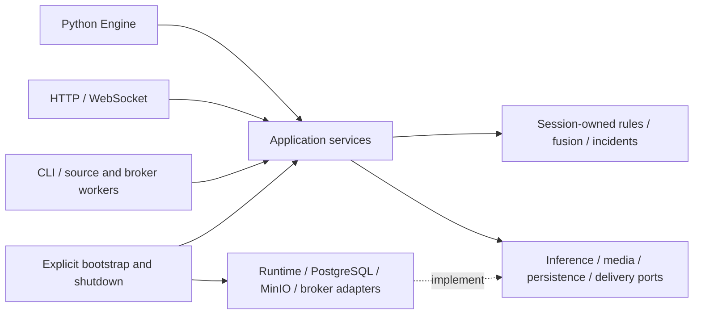

# InferOps shared engine and migration

For the implementation walkthrough, start with the [documentation tour](README.md),
[Hexagonal design](architecture.md), [full lifecycle](lifecycle.md) and
[Redpanda protocol](messaging.md). This guide focuses on contracts and release migration.

InferOps now has explicit domain decisions, application services and outbound
ports. The Python facade, HTTP endpoints, live inputs, CLI pipeline runs and
workers call the same session-owned processing services. Existing model runtimes,
tracking, fusion windows, expression evaluation and project plugins retain their
implementations, with canonical homes in domain and outbound adapter layers.

The duplicate server, pipeline runner, global stores and per-frame evidence sinks
have been removed after real CPU/CUDA video verification. Public `Model`,
`InferenceSession` and SDK routes remain. Internal module paths now follow the
consolidated layer structure; project plugin imports/configuration must use the
canonical paths. The
[architecture gallery](architecture/index.html) describes the current engine.
Deployment capacity and performance acceptance still require measurement on the
intended hardware with evidence capture enabled.

## Boundaries and resource ownership

| Location | Responsibility |
| --- | --- |
| `inferops/public.py` | Stable `Engine` facade for prediction, complete runs and explicit sessions |
| `inferops/domain/` | Media contracts, fusion/incident decisions and evidence policy |
| `inferops/application/` | Model pool, isolated pipeline sessions, evidence, jobs and outbox delivery |
| `inferops/ports/` | Application-owned contracts for external capabilities |
| `inferops/adapters/inbound/` | Request and media input translation |
| `inferops/adapters/outbound/` | Project loading, persistence, storage and media implementations |
| `inferops/bootstrap.py` | Construct resources from explicit configuration and connect adapters |
| `inferops/adapters/outbound/stages/factory.py` | Explicit project stage construction |

Domain and application modules cannot import concrete adapters, HTTP code,
deployment settings, service clients or observability SDKs. Shared pure schemas
and established calculation algorithms are allowed. The AST checks in
`tests/test_hexagonal_boundaries.py` enforce these rules.

Importing `Engine` or `Model` creates no network clients and reads no deployment
settings. `Engine.from_project()` builds an explicit definition and defaults to
in-memory persistence with evidence disabled. Entering the async context starts
its owned resources. Server startup explicitly loads settings and constructs
production adapters. Runtime backends load lazily into an engine-owned bounded
model pool; tracking, fusion and incident cooldown state belong to sessions.

Project loading never activates a global project or adds its parent to
`sys.path`. Relative plugins resolve into a generated namespace for that project
path and configuration revision. Captured Python source bytes keep existing
definitions independent of later edits, including plugins imported lazily.
Configuration editing validates candidate YAML and references before replacing
files. New sessions use the newly compiled revision; existing sessions retain
their original definitions and backends.

## Default server services

| Service | Role and failure behavior |
| --- | --- |
| PostgreSQL | Authoritative session/job lifecycle, events, accepted incidents, evidence metadata and inbox/outbox transactions. A failed acceptance transaction is reported as a persistence error, never as durable acceptance. |
| MinIO | Completed snapshots, clips and checksummed artifact manifests. Unavailable storage leaves recoverable spool material and a visible retry outcome. |
| Redis | Optional rebuildable transient caches. It does not own sessions, deduplication, incidents or evidence records. |
| Redpanda | Durable event transport and broker input/output. Committed outbox records survive broker outages. Capture does not wait for broker delivery. |
| Prometheus | Processing latency/drops, evidence states, capture queues, spool usage/capacity and outbox pending/failure/age measurements. |
| Grafana | Provisioned application and infrastructure dashboards. |
| Persistent local spool | Capture frames, manifests and encoded artifacts awaiting verified object storage. Docker mounts the `evidence-spool` named volume; native servers use `INFEROPS_SPOOL_PATH`. |

SQLite and `FilesystemStorage` are optional development/testing implementations.
The filesystem evidence store and capture spool have separate roles and should
use separate directories. Back up PostgreSQL, object storage and recoverable
spool together; deleting the spool destroys retry material even when database
records remain. `docker compose down -v` deletes named volumes.

The supported deployment is one processing owner process with many sessions.
Do not start independent API/worker owners against the same project records as
a substitute for distributed ownership. Cross-host temporal state migration and
automatic reconstruction of tracking/fusion state are deferred.

## Sessions and clocks

The engine generates each session ID and capability. External stream names are
metadata and may repeat. HTTP continuation requires `X-Session-Capability` plus
the generated session ID; supplying a name or ID alone grants no ownership.
Legacy image calls without a session handle are isolated one-shot executions.
Live browser connections, camera streams, jobs and Python runs receive their
own sessions. HTTP sessions expire after five idle minutes; process restart
interrupts prior live sessions and reconnecting creates new state.

| Time | Responsibility |
| --- | --- |
| Media time, nanoseconds | Fusion windows, temporal cooldowns and evidence pre/post windows |
| Monotonic process time | Idle expiry, acquisition estimates, latency and operational deadlines |
| Database UTC | Durable audit records, delivery scheduling and leases |

Video decoding reads frames incrementally using presentation timestamps; missing
PTS uses the advertised frame rate with explicit estimated provenance. Camera or
browser inputs may supply media timestamps; otherwise capture intervals provide
an estimated timeline. Equal timestamps use frame sequence as the tie-breaker.
Backwards media time creates a fresh timeline and resets temporal state. Evidence
never combines different timelines. Persistent deadlines never store a process's
monotonic timestamp for interpretation after restart.

Offline processing applies backpressure. Live adapters keep one processing frame
and one replaceable pending frame and count drops. Evidence observes decoded
input before inference drops, within its own capture budget. Required model calls
remain sequential unless an explicit `model_group` declares independent models;
group results merge in declaration order. Cancelling a backend await waits for
the underlying call before resources are closed.

## Durable incidents, capture and delivery

Acceptance persists events, incidents, evidence requests and outbox messages in
one transaction. Broker input also reserves its stable inbox identity in that
transaction. Outbox publication is at least once: a crash after acknowledgment
but before marking delivery can publish again. Consumers must deduplicate stable
event IDs. Webhook requests carry `Idempotency-Key`; remote effects are only
idempotent when receivers honor that key. WebSockets are notifications; clients
query persisted state to recover missed updates.

Capture starts directly from committed requests, independently of Redpanda.
Frames and manifests use checksummed files, file synchronization, atomic rename
and directory synchronization. Database progress follows durable spool writes.
Encoding writes reusable artifact bytes; uploads use deterministic keys and
checksum verification. Completed spool material is removed after the metadata
commit succeeds. Startup reconciliation handles interrupted writes, missing
material, upload/metadata disagreement and pending requests. A crash cannot
restore camera footage that was never captured or synchronized.

| Evidence state | Meaning |
| --- | --- |
| `Pending` | Capture, encoding, upload or a scheduled retry remains actionable |
| `Saved` | Required snapshot and clip exist and the sampled requested window is covered |
| `Incomplete` | Usable evidence exists with missing artifacts, intervals or interrupted context |
| `Failed` | No usable required artifact is saved and the current attempt cannot complete |

Records include requested/actual media windows, missing intervals, errors,
artifact references, attempts and retry availability. Queue, memory or spool
exhaustion produces explicit capture outcomes while preserving the accepted
incident. Transient upload retries reuse the evidence ID and retained artifact
bytes. Completed JSON artifact manifests include requested/actual windows,
missing intervals, artifact checksums and outcome reasons. Manual retry needs
usable retained capture material. Completed evidence
is retained until manual deletion; deletion records a durable tombstone and
retries interrupted removal instead of recreating artifacts on restart.

Default capture is a snapshot plus a five-second pre/five-second post clip, up
to 10 sampled FPS. The 64 MiB session/256 MiB global frame memory, 64 active
captures, two encoding workers, 10 GiB spool, 1 GiB disk reserve and retry waits
of 1/5/30 seconds are provisional. Server overrides use
`INFEROPS_EVIDENCE_<CONFIG_FIELD>`, for example
`INFEROPS_EVIDENCE_SAMPLE_FPS` or `INFEROPS_EVIDENCE_MAX_SPOOL_BYTES`.
`INFEROPS_EVIDENCE_RETRY_DELAYS=1,5,30` accepts comma-separated seconds.
Five additional seconds of byte-bounded history cover delayed inference
decisions (`INFEROPS_EVIDENCE_PROCESSING_LAG_SECONDS`). This does not expand the
requested clip window. Shutdown drains capture/upload work for up to 30 seconds
(`INFEROPS_EVIDENCE_SHUTDOWN_TIMEOUT_SECONDS`), then leaves pending durable
material for startup recovery. All these overrides are forwarded by Compose.

## CLI, workers and rollback

`inferops pipelines run <pipeline> <image-or-video>` uses the same production
pipeline application as HTTP. It prints an incremental run summary and evidence
records. Source workers construct their source with the engine's registry and
transport. Stateful processing stays ordered within each generated session.

Topic workers reserve inbox identities from `topic:partition:offset`, persist
outputs in the transactional outbox, and then commit only the processed
partition's `offset + 1`. A durable-processing failure stops consumption before
a later offset can skip the failed input. Inputs without broker coordinates must
supply a stable `event_id` or `id`. Each message represents one frame or metadata
record; video files use the job API. JSON media input may use `image_base64`, or
`frame_ref` backed by the configured object store. Default broker ownership is
scoped by topic, partition and external key; generated internal IDs own all
temporal state. Worker capacity and idle controls are
`INFEROPS_WORKER_MAX_SESSIONS` and `INFEROPS_WORKER_SESSION_IDLE_S`.
Graceful shutdown preserves admitted queued jobs for restart; running jobs
become visibly interrupted failures. Explicit client cancellation remains a
distinct cancelled outcome.

Rollback uses a designated previous release artifact rather than an alternate
execution path in the current package. Stop admission and quiesce sessions before
changing releases and restore the matching versioned project configuration.
Preserve database, object and spool volumes; never roll back
the schema. Additive event/alert projections keep expanded evidence data readable.
The integration test extracts the archived compatibility wheel into an isolated
process, reads and plays new-system artifacts, recovers a pending upload,
processes additional work, then upgrades again. Set
`INFEROPS_TEST_ROLLBACK_WHEEL` to test the designated release artifact. An arbitrary
historical commit is not supported. Interrupted temporal state is not resumed.

## Verification and remaining release gates

See [the verification report](cleanup-verification.md) for measured CPU replay
results, actual process-death recovery tests, rollback checks and reproduction
commands. The current CPU measurements do not establish real-time capacity.

Focused tests cover library imports, project/plugin revision isolation,
dependency boundaries, session/time behavior, transactions and leases,
checksummed spool recovery, evidence failure/retry/delete, worker backpressure,
live drops and exact broker acknowledgments. SQLite and fake storage exercise
these contracts without the production stack; disposable PostgreSQL tests are
enabled with `INFEROPS_TEST_PG_URL`.

Before a production cutover, run the same media, models and concurrency through
both execution versions on the deployment host. Benchmark capture enabled and
include incident bursts and slow MinIO. Record p50/p95/p99 reply latency, frame
drops, evidence completion, memory, spool growth and delivery lag. Exercise
rollback using incidents and artifacts created by the new engine, including
pending upload/outbox work, then upgrade again. Publish measured capacity before
turning provisional limits into production defaults. Full-stack outage testing and benchmark-derived capacity remain deployment
acceptance work; unit tests do not establish those guarantees.
