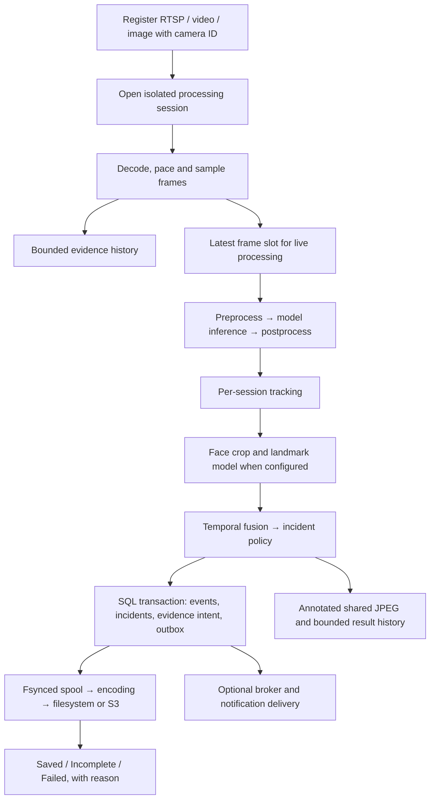

# Unified dashboard and runtime

The entry point is `/ui/`. The operations console uses one HTML shell, one shared API client and one stylesheet. Navigation switches views without reloading the page. `/ui/cameras`, `/ui/guide`, `/frontend` and `/frontend/` serve the same shell for existing bookmarks. No separate frontend server, external fonts or JavaScript build step is required.

| View | Controls |
| --- | --- |
| Overview | Workspace counts, readiness, GPU/RAM telemetry and measured capacity |
| Sources | Register, upload, edit, start, stop and remove sources; previews, history, recordings and live players |
| Pipeline & models | Actual stage order, runtime placement and checkpoint conversion |
| Inference playground | Browser camera, image, video and RTSP execution with results |
| Background jobs | Submit JSON payloads, inspect results, cancel active jobs and retry failed/cancelled runs |
| Activity & evidence | Events, alerts, capture records, clips, retry and explicit retention review |
| Configuration | Schema-backed settings forms, grouped logical models, linked policies, new configuration drafts, validation, live reload and optional Advanced YAML |
| Services & runtime | Service health, execution placement, deployment components and Triton statistics |
| API explorer | Search the running OpenAPI schema and send requests from the console |
| Customize workspace | Saved appearance, density, layout, default view and refresh preferences |
| Interface guide | Embedded workflow guide and configured service ports |

Use **Ctrl/Cmd+K** to search views and quick actions. On small screens, the menu button opens the same navigation. The active project pipeline selector stays available above every view. Leaving the Playground stops browser camera capture and live video analysis; registered backend sources continue processing.

## Workspace customization

Choose dark, light or system theme; mint, blue or violet accent; comfortable or compact density; and source grid or list layout. Choose a default view and show or hide overview resource cards. These preferences save automatically in this browser and apply across all views. **Restore defaults** resets them.

Automatic refresh can be set to 2, 5, 10 or 30 seconds, or **Manual only**. One scheduler refreshes the active view and pauses polling while the document is hidden. Manual refresh buttons remain available. This preference controls console snapshots; live camera analysis and WebSockets have their own frame/event cadence.

Per-source processing resolution, inference/evidence/preview rates, JPEG quality, transport and recovery settings remain in the source editor. Project/platform behavior is edited through Configuration. Live sections can reload after save; startup and model-artifact changes can require preparation or an engine restart.

## Built-in API explorer

The explorer discovers the current server's `/openapi.json`, including new HTTP routes added by the program. Search by method, path, tag or operation. Selecting an endpoint generates path/query/header fields, a JSON body or multipart file fields. Requests use the current server; no second API connection is configured.

The response panel shows status, elapsed time, headers and formatted JSON or text. Binary responses offer a download link. Copy the response or a shell-quoted cURL command, or cancel a pending browser request. Cancellation stops waiting in the browser; use a job's Cancel action to stop server-side job execution. Request history retains the last 15 method/path/status entries for this visit. Bodies, query values and headers are not saved in history or browser storage. Custom headers can carry a session capability returned by the API.

Requests execute real program operations. Validation and HTTP errors remain visible in the response panel. Redirecting service endpoints do not automatically follow to another application; optional MinIO, Grafana and Prometheus administration interfaces are available from Services & runtime. Swagger and ReDoc remain available as API reference tools. WebSocket inference remains in the Playground; the request composer handles HTTP.

## Start locally

```bash
# Choose one ORT wheel: CPU or CUDA, not both.
pip install -e '.[server,cuda,video]'
python scripts/serve_local.py --runtime cuda --port 8081
# CPU alternative: install .[server,cpu,video], then --runtime cpu
```

Start dependencies first with `docker compose up -d postgres mediamtx`,
then open `http://127.0.0.1:8081/ui/`. The native API uses PostgreSQL records,
persistent-disk evidence and MediaMTX routing. Its `.run/local-control` directory holds
evidence, uploads and a recovery spool. Retired local data was discarded; the new durable
stores start empty without importing SQLite records.

For the complete container deployment:

```bash
cp .env.example .env  # first setup only; preserve existing configuration
docker compose up -d --build
```

PostgreSQL, MediaMTX and one API start by default, after model preparation.
Completed evidence persists on the `engine-data` volume.
MediaMTX adds live WebRTC/HLS, original recording and playback. CPU mode needs no GPU.

| Optional component | Enable for | How |
| --- | --- | --- |
| MinIO/S3 | Shared evidence object storage | `--profiles storage` (launcher also selects the S3 adapter) |
| Redpanda | Kafka consumers and topic workers | `--profiles broker` |
| Prometheus + Grafana | Metrics collection and dashboards | `--profiles monitoring` |
| Triton | Shared inference and qualified batching | `MODE=triton` |

Use `make run-container MODE=cpu RUN_ARGS='--profiles broker,monitoring'` when
those optional services are needed. Keep configured database/object endpoints
and persistent volumes when upgrading. See the [technology stack](technology-stack.md).

## Model preparation

Pipeline & models includes checkpoint upload / project-path conversion, job status, logs, validation reports and ONNX downloads. RF-DETR is the initial optional adapter; it runs in a separate CPU environment and stages exports without replacing active weights. See [checkpoint prerequisites and validation limits](checkpoint-conversion.md).

## The actual pipeline



The Pipeline view gets stage order from the same `execution_declarations` function used by the executor, including automatic tracking insertion. Each model stage handles its own preprocessing/postprocessing. Custom projects may have different stages; the inspector shows their actual order. It does not present a fixed drawing as every project's execution plan.

Source ID remains stable; every start creates a new session and timeline. Results, previews and new evidence records retain camera/session identity. Deleting a registration retains history and saved evidence. Activity includes inline clip playback, explicit incomplete-save reasons and retry controls.

Registered RTSP readers use per-source capture threads, independent FFmpeg options, reconnect backoff and a latest frame slot. Video/image inputs use incremental file decoding. The legacy stream API remains for compatibility; register sources for persistent controls and restart recovery.

With the default media router, the same reader consumes MediaMTX's shared RTSP
path. **Live video** uses the upstream player; annotated JPEGs remain separate.
Disable **Annotated wall previews** per source to skip their drawing, encoding
and writes while preserving analysis/results/incident evidence. Browser players
only connect while their dialog is open and the page is visible.

Source FPS, inference FPS, evidence FPS and preview FPS are separate. Set the source's evidence sampling FPS explicitly (for example 10) to observe history faster than inference (for example 2). Leaving it empty follows inference FPS. Actual coverage still depends on decoded frames and available capacity; requesting 10 FPS cannot create missing footage. Processing resolution is a downscale limit; model tensor sizes remain fixed. Neither a lower resolution nor JPEG quality is an accuracy guarantee.

## GPU admission and evidence performance

Local GPU models on the same device share bounded round-robin admission by processing session. `INFEROPS_ADMISSION_LOCAL_DEVICE_CAPACITY=1` is the conservative default; CPU models retain per-model admission. Maximum queued work and waiting age are configurable, and live waiting frames expire after the source's maximum frame age (500 ms by default). Native inference and filesystem commits drain before cancellation releases a slot; queued cancellation does not consume a slot. These are admission/response deadlines, not a guarantee that a running native GPU operation can be forcibly stopped.

Triton uses a different shared limit, `INFEROPS_TRITON_CONCURRENCY=64`, so batch-one requests from multiple sessions can overlap at the server. Each session still processes frames in order. Request IDs, input name/type/shape validation, queue deadlines and client deadlines are explicit. The RPC bound is not a camera-count recommendation.

The evidence spool rebuilds byte accounting once on startup and accounts for replacements, partial temporary writes and deletion incrementally. It no longer walks every pending capture directory for every frame. Fsync, atomic replacement, checksums, recovery manifests, byte quotas and disk reserves remain enabled. One process exclusively owns each spool directory; manual edits or another writer require stopping the owner and reconciling on restart.

Keep one API/control owner. Optional static camera workers now use PostgreSQL leases and transaction fencing, separate persistent spool volumes, generation-specific artifact keys and authenticated routed controls. The API owns the delivery relay and jobs; workers recover only their own scope. See [static workers](static-workers.md). Duplicate combined owners, API replicas and automatic cross-host shard reassignment remain unsupported.

Activity & evidence includes a retention preview by cutoff and owner. Deletion is explicit and uses the tombstone workflow; pending captures and pending delivery are protected. There is no automatic destructive retention policy. The CLI also supports evidence retention and delivered-outbox pruning with dry-run defaults.

## Structure

Admission defaults also live under `runtime.admission` in `configs/platform.yaml`:
`local_device_capacity`, `remote_outstanding`, `max_pending` and `max_queue_age_ms`.
The corresponding `INFEROPS_ADMISSION_*` variables override configuration and
legacy `INFEROPS_MODEL_CONCURRENCY` / `INFEROPS_TRITON_CONCURRENCY` variables.
The local launcher reads the same settings. Source waiting-frame age is separate
from the resource queue limit. Worker budgets and source limits are configured
per shard; global GPU admission across workers belongs to Triton.

```text
inferops/domain/                  Source, capacity, model, pipeline and evidence contracts
inferops/ports/                   Source store, inference, persistence and delivery interfaces
inferops/application/             Ordered sessions, shared admission, source lifecycle, incidents/evidence
inferops/adapters/inbound/http/   Unified HTML shell, dashboard.css, shared console.js + workflow modules + HTTP routes
inferops/adapters/inbound/        Registered media readers and compatibility input adapters
inferops/adapters/outbound/       Model runtimes, qualified Triton repository, SQL/catalog, spool, storage, telemetry
deploy/compose.yaml              Minimal default and optional service profiles
deploy/compose/                  CPU/CUDA/Triton runtime overlays
scripts/prepare_triton.py        Non-destructive ONNX batch qualification + serving config generation
scripts/benchmark_capacity.py    CPU/CUDA/Triton sweeps through the actual pipeline
docs/benchmarks/                 Raw measurement data and charts
.run/                           Runtime files, generated models, reports and caches
```

## Capacity and testing

Choose the same evidence sampling FPS in the capacity dialog as on the source.
Empty follows inference FPS. The benchmark accepts `--evidence-fps 10` for
independent faster observation; such a profile cannot reuse a lower sampling-rate
measurement. Expired inference admissions are counted as drops, not processed
frames. Throughput reports from before that accounting correction remain
historical and are not promoted as current capacity.

Triton clients load lazily. After an API restart, process a representative source
before inspecting capacity so the effective server configuration is known. An
idle owner without loaded model metadata stays unmeasured rather than assuming
the remote server still has a previous configuration.

The wall shows actual GPU/RAM telemetry. In Triton mode it reads the inference server's GPU metrics, including from an API container without NVML. The Services view shows actual Triton inference counts, execution counts and average executed batch size. These are server counters, distinct from the client request's batch size.

Capacity results match software, model artifacts, pipeline configuration, evidence policy, runtime, GPU identity, CPU/RAM, storage type/filesystem, concurrency, resolution, FPS and preview settings. A software or workload change intentionally invalidates prior recommendations. Unmeasured profiles stay unmeasured; VRAM alone cannot determine maximum camera count. Short passing runs are observations, not a certified maximum or long-soak result.

```bash
python scripts/benchmark_capacity.py --runtime cpu --resolutions 640x480 --fps 1,2 --counts 1,2,4 --seconds 30 --warmup 5 --evidence --preview
python scripts/benchmark_capacity.py --runtime cuda --resolutions 640x480,1280x720 --fps 2,5 --counts 1,2,4,8 --seconds 30 --warmup 5 --evidence --preview
# With a running Triton server:
python scripts/benchmark_capacity.py --runtime triton --triton-url 127.0.0.1:8001 --resolutions 640x480 --fps 2,5 --counts 1,2,4,8 --seconds 30 --evidence --preview
```

Use representative footage. The acceptance gate is every source reaching 95% of target FPS, aggregate p95 processing latency ≤ 1 second, and zero processing errors. The sweep stops higher counts after a failure for that profile. A repeated local file does not test independent RTSP network conditions. Run incident bursts, camera disconnects and a long soak before a production capacity claim.

See [Triton configuration and qualification](triton-serving.md) and [source API details](source-control.md).
Historical [runtime measurements](benchmarks/unified-2026-10-19.json) retain their
original software and workload context; measure new configurations separately.
