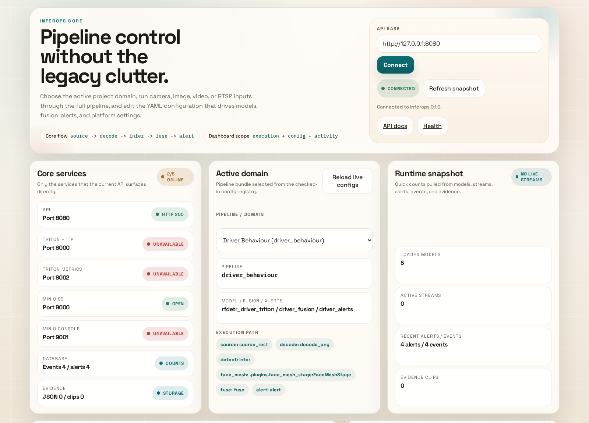
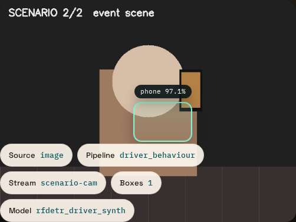
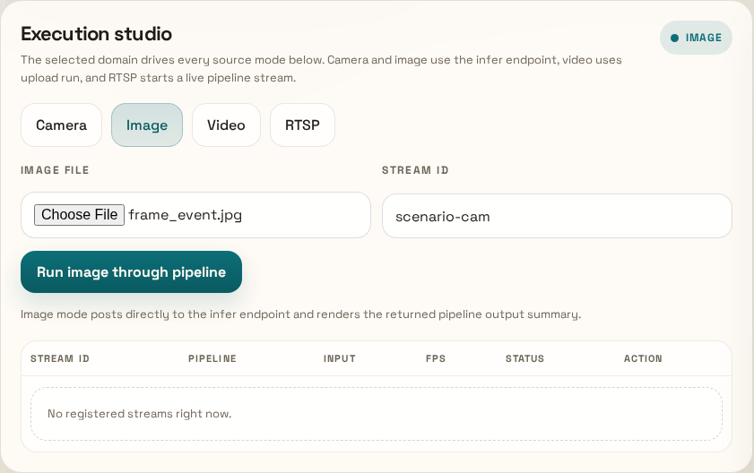
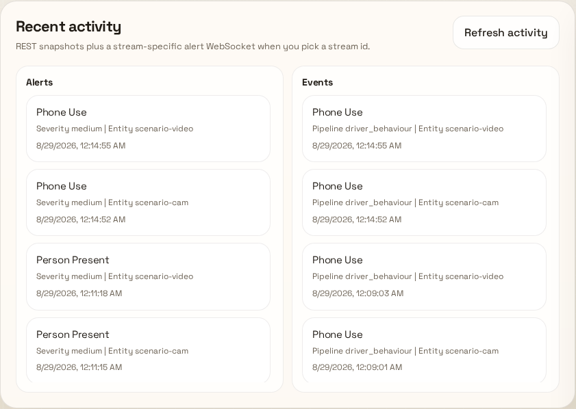
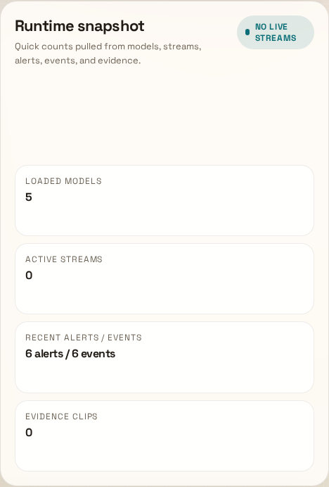
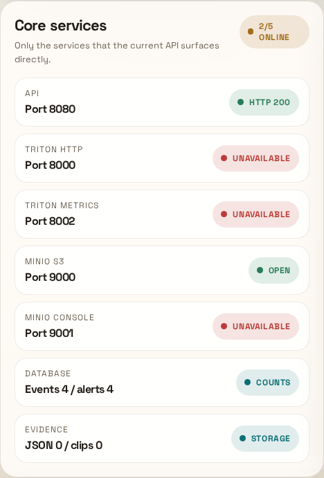
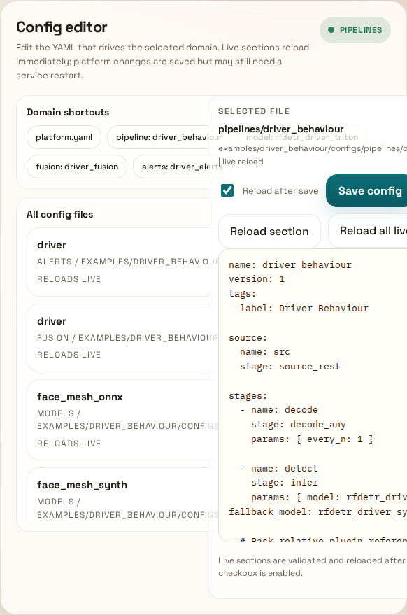

# InferOps

InferOps is a model-agnostic inference platform that loads models, pipelines,
fusion rules, and alerts from YAML. It can run as a single-process CPU service
for local development or as a broker-backed stack with Triton, storage, and
observability services.

At the core is a typed pipeline DAG composing:

**source → decode → preprocess → infer → postprocess → track → fuse → alert → sinks**

The platform itself knows nothing about any particular computer-vision
problem. A concrete product is a **domain pack**: a directory of YAML plus
optional Python plugins that the platform loads at runtime. The bundled
`examples/driver_behaviour` pack is one such product and can be deleted or
replaced without touching the platform — see [Domain packs](#domain-packs).

## What you get

- YAML-driven model registry, pipeline specs, fusion rules, and alert rules
- ONNX Runtime, Triton, TensorRT and synthetic backends, plus pack-provided backends
- In-process and Redpanda transports behind the same abstraction
- FastAPI, WebSocket fan-out, and Prometheus metrics
- Worker entrypoints for source-driven and topic-driven pipelines
- Evidence capture (JSON, snapshots, MP4 clips) with YAML-defined trigger rules
- A generic dashboard that renders any pack's pipelines, detections, signals and alerts
- `inferops domain init` to scaffold a runnable pack for a new project in one command

## What it looks like running

Every image below is a real capture of the stack serving traffic, taken by
`make scenario` (see [End-to-end browser scenario](#end-to-end-browser-scenario)).
They are regenerated by the same run that asserts the behaviour they show, so
they cannot drift from what the code actually does.

### Dashboard

The control surface: pick the active domain, run camera/image/video/RTSP input
through the full pipeline, and edit the YAML that drives it.



### Live inference and alerting

A frame through `source → decode → infer → track → face_mesh → fuse → alert → sinks`.
The overlay shows the detection boxes, the confidence, and which model actually
served the request — here the `rfdetr_driver_synth` fallback, because this host
has no GPU and no Triton.



Fusion aggregates detections over its rolling window and the alert engine
applies severity mapping, dedupe, and cooldown before emitting.



### Events and alerts are persisted

Both survive the request and are read back from storage through
`GET /v1/events` and `GET /v1/alerts`, tagged with the pipeline that produced
them. Two entries here: one from a single uploaded frame, one from a 187-frame
dashcam clip.



### Runtime and service state

Counters for loaded models, active streams, stored alerts/events, and evidence
clips.



Only the services the API actually surfaces. Triton and the MinIO console are
correctly reported unavailable under `make serve-mock`, which starts neither.



For device and execution-provider detail — including whether a model that asked
for a GPU silently landed on CPU — read the `runtime` block of
`GET /v1/system/status`:

```jsonc
{
  "runtime": {
    "onnxruntime_version": "1.28.0",
    "onnxruntime_import_error": null, // non-null means the wheel cannot load
    "available_providers": ["AzureExecutionProvider", "CPUExecutionProvider"],
    "cuda_available": false,
    "cuda_device_count": 0,
    "force_cpu": false,               // set INFEROPS_FORCE_CPU=1 to pin to CPU
    "models": [                       // one entry per backend built so far
      {
        "model": "rfdetr_driver_synth",
        "backend": "SyntheticDetectorBackend",
        "device": "cpu",              // "cpu" | "gpu" | "remote" (Triton)
        "requested_device": "cpu",
        "downgraded": false,          // true = asked for GPU, got CPU
        "reason": "synthetic backend runs in numpy on the CPU",
        "active_providers": []
      }
    ],
    "models_downgraded": []           // alert on this being non-empty
  }
}
```

`models_downgraded` is the field to alert on: a model spec that asks for
`device.preferred: gpu` and silently ends up on CPU — missing CUDA libraries, no
visible device, or an ONNX Runtime built without the CUDA provider — otherwise
looks exactly like a healthy GPU deployment, only slower.

### Config editor

Every YAML in the active config surface, editable in place. Model, pipeline,
fusion, and alert sections reload live; platform changes are saved but may need
a restart.



## Quick start (local, CPU-only)

Prerequisites:

- Python 3.10+
- `make`
- Optional: `jq` for prettier JSON output from `curl`

Run all `make` commands from the repository root; the root `Makefile` is the only Makefile entrypoint.

Level 1 sets up InferOps itself. This installs dependencies, validates the
core platform config, installs the native `make serve` prerequisites on
Debian/Ubuntu Linux, and starts the API/dashboard with no domain pack — the
core `tiny_classifier` pipeline runs through the real ONNX Runtime backend so
every surface (API, dashboard, video upload, live WebSocket, evidence) can be
exercised with nothing downloaded:

```bash
python -m venv inferops/.venv
source inferops/.venv/bin/activate
make setup
make validate
make serve-mock
```

Level 2 selects one domain pack for the process. `make domains` lists the
packs found under `examples/` and `domains/`; the bundled driver behaviour pack
includes its own model specs, pipelines, fusion rules, alert rules, plugins,
Triton configs and model asset installers:

```bash
make domains
make setup DOMAIN=driver_behaviour       # installs the pack's extras + assets from domain.yaml
make validate DOMAIN=driver_behaviour
make test DOMAIN=driver_behaviour        # core suite, then the pack's own tests
make serve-mock DOMAIN=driver_behaviour
```

Level 3 is your own project:

```bash
make new-domain NAME=ppe_site LABELS=person,helmet,vest
make serve-mock DOMAIN=ppe_site          # runs immediately on the synthetic detector
```

Open `http://localhost:8080/docs` after the server starts. The dashboard is available at `http://localhost:8090/dashboard.html`.

Notes:

- `make setup` installs Python dependencies, the selected pack's extras and model assets (both declared in its `domain.yaml`), and runs config validation. On Debian/Ubuntu Linux it also bootstraps native `make serve` prerequisites by downloading `minio` and `mc` into `.tools/bin` and installing `redpanda`/`rpk` from the official APT repository.
- `GPU=1 make setup` (or `make install GPU=1`) swaps the CPU `onnxruntime` wheel for `onnxruntime-gpu`. Check the `runtime` block of `GET /v1/system/status` afterwards; `models_downgraded` must be empty.
- Use `SKIP_RUNTIME=1 make setup` if you only want the Python environment and plan to use `make serve-mock` or `make up`.
- `make setup-runtime` reruns only the native runtime bootstrap when you need to repair or upgrade the local `make serve` prerequisites.
- `make serve` is the native broker-backed path. After `make setup`, it expects local `minio` plus `rpk`/`redpanda` binaries to be available either from `.tools/bin` or the system PATH.
- Core InferOps starts with only `configs/` unless you pass `DOMAIN=<pack>` or set `INFEROPS_ACTIVE_DOMAIN=<pack>` (or `INFEROPS_DOMAIN_ROOT=/path/to/pack` for a pack outside the repository).
- The checked-in local profile in `configs/platform.yaml` sets `transport.kind: redpanda`; use `make serve-mock` or set `INFEROPS_TRANSPORT_KIND=inproc` for the lightweight local path.
- If your shell does not resolve the `inferops` console script, use `python -m inferops.cli ...` instead.
- If you need PyAV-based video stages, install `pip install -e ".[dev,video]"`.

### Triton accelerated local run

For the driver-behaviour pipeline on an NVIDIA GPU host with Docker and the
NVIDIA Container Toolkit installed, start Triton together with the local API
stack:

```bash
make serve DOMAIN=driver_behaviour
```

This starts Triton on HTTP `8000`, gRPC `8001`, and metrics `8002`, using the
pack's `examples/driver_behaviour/model_repository` as the model repository
(a pack's `model_repository/` replaces the core one when present; `make`
resolves it through `inferops domain env`). The RF-DETR Triton config is
fixed-batch because the current ONNX artifact has batch size `1`; for higher
throughput, export a dynamic-batch ONNX or a TensorRT plan, then enable Triton
dynamic batching in that model config.

`make serve` auto-starts Triton for any pack whose `domain.yaml` says
`triton: true`, and stops any stale Triton process already bound to
`8000/8001/8002` before restarting it. To force CPU-only serving, use
`make serve DOMAIN=<pack> WITH_TRITON=0`; to force Triton on, `WITH_TRITON=1`.
When Docker is unavailable, `make serve` falls back to a native Triton binary if
`tritonserver` is on `PATH` or installed at `/opt/tritonserver/bin/tritonserver`.

For RunPod/DeepStream images, make sure Triton points at the populated InferOps
repository (`/workspace/inferops/model_repository`) and wait for the model, not
only the server, to become ready. With `--model-control-mode=explicit`, add
`--load-model=rfdetr_driver_behaviour_onnx` or call the repository load API at
boot; otherwise the first API request pays the model-load cost. Also match the
image CUDA runtime to the host driver: DeepStream 9.0 / Triton 26.01 uses CUDA
13.1 and requires a newer driver than 570.x, so on a 570.x host use an older
Triton/DeepStream image or upgrade the host driver before expecting GPU Triton
instances to load.

#### Recommended RunPod start command

Override the container start command (Pod template -> Docker command) with the
following so models are pre-loaded with TensorRT engines warmed and the GPU/CPU
memory pools are sized for streaming. Replace 570 with 580 if the host driver
supports DeepStream 9.0.

```bash
/opt/tritonserver/bin/tritonserver \
  --model-repository=/workspace/inferops/model_repository \
  --model-control-mode=poll --repository-poll-secs=15 \
  --load-model=rfdetr_driver_behaviour_onnx \
  --load-model=face_mesh_onnx \
  --load-model=tiny_classifier \
  --cuda-memory-pool-byte-size=0:268435456 \
  --pinned-memory-pool-byte-size=268435456 \
  --response-cache-byte-size=67108864 \
  --backend-config=onnxruntime,enable-cuda=true \
  --log-info=false --strict-readiness=true \
  --grpc-port=8001 --http-port=8000 --metrics-port=8002
```

If the host driver is stuck at 570.x, swap the image to
`nvcr.io/nvidia/deepstream:7.1-triton-multiarch` (CUDA 12.4, driver >=535) and
keep the same command. For GPU dashboards, run the DCGM exporter sidecar:

```bash
docker run -d --gpus all --rm -p 9400:9400 \
  --name dcgm-exporter nvcr.io/nvidia/k8s/dcgm-exporter:3.3.7-3.4.2-ubuntu22.04
```


### Smoke-test the API

```bash
curl http://localhost:8080/healthz
curl http://localhost:8080/v1/models
curl -F 'image=@some.jpg' -F 'stream_id=demo' \
  http://localhost:8080/v1/infer/driver_behaviour
```

The bundled `driver_behaviour` pipeline runs the RF-DETR driver model when
available and falls back to the synthetic detector in local development, then
passes results through fusion, alerts, and evidence storage.

## Domain packs

A domain pack is the whole of a project's domain knowledge, kept out of the
platform:

```
examples/<name>/               # or domains/<name>/, or any INFEROPS_DOMAIN_ROOT
  domain.yaml                  # manifest: label, extras, triton, prewarm, assets, scenario
  __init__.py                  # the pack is importable as the package <name>
  configs/
    models/*.yaml              # ModelSpec: backend, artifact, inputs/outputs, labels, plugins
    pipelines/*.yaml           # PipelineSpec: stages, sinks, tracking
    fusion/*.yaml              # FusionSpec: signals, windows, rules, state machine
    alerts/*.yaml              # AlertSpec: severity, dedupe, cooldown, sinks
    platform.yaml              # optional overrides merged over core configs/platform.yaml
  plugins/                     # stages, pre/post-processors, annotators, backends
  model_repository/            # optional Triton/ONNX artifacts; replaces the core repository
  scripts/                     # optional asset installers referenced from domain.yaml
  tests/                       # optional; run with `make test DOMAIN=<name>`
```

Rules that keep the platform generic:

- **Plugins are referenced from YAML, never imported by the core.** Use the
  pack-relative form `.plugins.<module>:<Class>` for stages
  (`stage:`), pre/post-processors (`plugin:`), evidence annotators
  (`annotator:`) and backends (`backend:`). Selecting the pack puts its parent
  directory on `sys.path`, so a pack can live outside the repository.
- **`backend:` is open.** Built-ins are `onnxruntime`, `triton`, `tensorrt`
  and `synthetic`; anything else is a `module:Class` reference to an
  `InferenceBackend` subclass shipped by the pack.
- **The synthetic detector is label-driven.** `tags.emit:
  "label=every_n[@cx,cy,w,h]; ..."` decides which of the spec's `labels`
  fire and how often, so any pack can run and be tested with no weights.
- **Evidence triggers are YAML.** `sink_s3` keeps its sustained-alert timer
  running from `trigger_rules` (`class`/`min_score`, `class`/`max_score`,
  `signal`/`min`/`max`, or `alert`), or from a `trigger_flags`
  `module:callable`. With neither, the frame's alerts and fusion events count.
- **The dashboard reads two generic channels.** A stage that wants to show
  per-frame state sets `payload["signals"]` (`{name: number|string}`, rendered
  as chips) and `payload["overlay_boxes"]` (`[{label, box:[x1,y1,x2,y2],
  tone}]`, drawn on the preview). Both are forwarded by `/v1/infer` and the
  live WebSocket; nothing in the UI names a domain.
- **Tooling reads the manifest.** `make setup/serve/test/scenario` get pip
  extras, asset installers, Triton auto-start, prewarm lists, the model
  repository and the browser-scenario plan from `domain.yaml` via
  `inferops domain env`.

`inferops domain init <name> --labels a,b,c` (or `make new-domain NAME=...
LABELS=...`) writes a pack with a real ONNX detector spec (YOLO-style decode),
a synthetic fallback, fusion and alert rules for the first label, evidence
triggers, a README and a smoke test; it validates and serves immediately.
Other CLI helpers: `inferops domain list | info | env | setup-assets`.

## Configuration model

InferOps merges configuration in layers:

1. Code defaults from `inferops/core/config.py`
2. Platform defaults from `configs/platform.yaml`
3. One active domain selected by `INFEROPS_ACTIVE_DOMAIN` or `INFEROPS_DOMAIN_ROOT`
4. YAML specs in that active domain's `configs/models`, `configs/pipelines`, `configs/fusion`, and `configs/alerts` (a section present in the pack replaces the core section)
5. Environment variables such as `INFEROPS_*`

Common overrides:

- `INFEROPS_CONFIGS_DIR`: alternate config root, default `configs`
- `INFEROPS_ACTIVE_DOMAIN`: active domain name, for example `driver_behaviour`
- `INFEROPS_DOMAIN_ROOT`: explicit domain root, for example `examples/driver_behaviour`
- `INFEROPS_MODEL_REPOSITORY`: alternate model artifact root, default `model_repository`
- `INFEROPS_TRANSPORT_KIND`: `inproc` or `redpanda`
- `INFEROPS_TRANSPORT_BOOTSTRAP`: broker bootstrap, default `localhost:19092`
- `INFEROPS_TRITON_URL` and `INFEROPS_TRITON_HTTP_URL`: Triton gRPC and HTTP endpoints
- `INFEROPS_REDIS_URL`, `INFEROPS_PG_URL`, and `INFEROPS_S3_ENDPOINT`: backing service connections
- `INFEROPS_API_HOST`, `INFEROPS_API_PORT`, and `INFEROPS_API_CORS_ORIGINS`: API server settings

## Common CLI workflows

```bash
inferops domain list
inferops domain init ppe_site --labels person,helmet,vest
inferops validate --domain driver_behaviour
inferops preflight --domain driver_behaviour
INFEROPS_ACTIVE_DOMAIN=driver_behaviour inferops models list
INFEROPS_ACTIVE_DOMAIN=driver_behaviour inferops models show rfdetr_driver_synth
INFEROPS_ACTIVE_DOMAIN=driver_behaviour inferops pipelines list
INFEROPS_ACTIVE_DOMAIN=driver_behaviour inferops pipelines run driver_behaviour path/to/image.jpg
INFEROPS_ACTIVE_DOMAIN=driver_behaviour inferops pipelines run driver_behaviour ../train/test.mp4
INFEROPS_ACTIVE_DOMAIN=driver_behaviour inferops worker pipeline driver_behaviour
INFEROPS_ACTIVE_DOMAIN=driver_behaviour inferops worker topic driver_video \
  --input-topic inferops.frames \
  --output-topic inferops.results
```

`inferops validate --domain <name>` checks the manifest and the selected
domain's YAML contracts. `inferops preflight --domain <name>` also checks
backend dependencies, plugin imports, stage references, and local model
artifacts (a missing artifact is only a warning when the pipeline declares a
`fallback_model`). `inferops pipelines run` is the fastest local sanity check
when you want to execute a pipeline directly from the CLI with an image or
video file.

## HTTP API

Health and observability:

- `GET /`
- `GET /healthz`
- `GET /readyz`
- `GET /metrics`
- `GET /v1/system/status`

Registry and pipeline management:

- `GET /v1/models`
- `GET /v1/models/{name}`
- `POST /v1/models/reload`
- `GET /v1/pipelines`
- `GET /v1/pipelines/{name}`
- `POST /v1/pipelines/reload`

Execution:

- `POST /v1/infer/{pipeline}` for multipart image uploads
- `POST /v1/run/{pipeline}` for JSON payloads such as `{"video_path": "/path/to/video.mp4"}`
- `POST /v1/run/{pipeline}/upload` for multipart video uploads
- `POST /v1/jobs/{pipeline}`
- `GET /v1/jobs`
- `GET /v1/jobs/{job_id}`

Streaming, history, and evidence:

- `POST /v1/streams?pipeline=<name>`
- `GET /v1/streams`
- `DELETE /v1/streams/{stream_id}`
- `WS /v1/ws/{channel}`
- `GET /v1/events`
- `GET /v1/alerts`
- `GET /v1/evidence`
- `GET /v1/evidence/clips`

## Full local stack with Docker Compose

Use Docker Compose when you want the broker-backed stack with Redpanda,
Postgres, MinIO, Prometheus, and Grafana.

```bash
make setup DOMAIN=driver_behaviour
make up
```

To include Triton in the Compose stack, enable the `triton` profile:

```bash
cd inferops
docker compose --profile triton up -d
```

Important details:

- The `api` container is configured for `INFEROPS_TRANSPORT_KIND=redpanda`.
- The compose stack exposes API `8080`, Redpanda `19092`, MinIO `9000`, MinIO console `9001`, Prometheus `9090`, and Grafana `3000`; the Triton profile also exposes HTTP `8000`, gRPC `8001`, and metrics `8002`.
- Triton requires an NVIDIA GPU-capable Docker runtime. Without that runtime, use `make serve DOMAIN=driver_behaviour` and the pipeline will fall back to the synthetic detector when the Triton backend is unavailable.
- Stop and remove volumes with `make down`.

## Project layout

```
inferops/                # Python package: registry, pipeline runtime, API, workers, testing helpers
configs/                 # Core platform defaults + the core tiny_classifier reference pipeline
examples/                # Domain packs (configs, plugins, model_repository, scripts, tests, domain.yaml)
model_repository/        # Core model artifacts (tiny classifier); packs bring their own
scripts/                 # Setup, tiny-model builder, video demo, browser scenario
tests/                   # Core suite — runs with no domain pack active
deploy/docker/           # Container build assets
docker-compose.yml       # Local multi-service stack
../docs/images/          # Screenshots embedded above, refreshed by `make scenario --docs`
../frontend/             # Static dashboard served on :8090
```

## Development

```bash
make validate DOMAIN=driver_behaviour
make test                        # core suite only (no domain)
make test DOMAIN=driver_behaviour # core suite + examples/driver_behaviour/tests
make test-all                    # core suite + every pack that ships tests
make lint
```

Settings are computed once per process, so the core suite (`tests/`) always
runs domain-free and each pack's suite runs in its own pytest process with
that pack selected. A pack's `tests/conftest.py` is two lines:

```python
from inferops.testing import configure_test_env
configure_test_env(domain="my_pack")
from inferops.testing.fixtures import *  # mock S3, tiny model, clean DB
```

### End-to-end browser scenario

`make scenario` drives the dashboard in a real Chromium session against a
running stack and screenshots every step. It is a test, not a demo: each step
asserts, and it exits non-zero on the first failure — including on any console
error, uncaught JS exception, failed request, or non-2xx response observed in
the browser over the whole run. It works for any served pack: the pipeline,
whether repeated frames must raise an alert, and the sample video come from
the pack's `domain.yaml` `scenario:` block (override with `--pipeline`,
`--video`, `--expect-alert/--no-expect-alert`, or `SCENARIO_ARGS=...`).

```bash
make serve-mock DOMAIN=driver_behaviour   # terminal 1
make scenario                             # terminal 2
```

Requires the browser driver once:

```bash
pip install playwright && python -m playwright install chromium
```

| Step | What it exercises | Assertion |
| ---- | ----------------- | --------- |
| 1 | Dashboard loads and connects to the API | connected, models registered |
| 2 | Device / execution-provider reporting | `runtime` block present |
| 3 | Single frame through the full pipeline | one frame processed |
| 4 | Repeated frames until fusion escalates | an alert is emitted (when `expect_alert`) |
| 5 | Sample video via `POST /v1/run/{pipeline}/upload` | frames decoded (+ detections/alerts when `expect_alert`) |
| 6 | Events and alerts read back from storage | both panels non-empty (when `expect_alert`) |
| 7 | Config editor live reload | reload succeeds |
| 8 | Browser health across the whole run | zero errors of any kind |

Screenshots land in `.run/scenario/`. Regenerate the images embedded in this
README with:

```bash
python scripts/e2e_dashboard_scenario.py --docs
```

Detections note: with no GPU, no Triton, and no downloaded weights the driver
pack's `detect` stage falls back to `rfdetr_driver_synth`, the label-driven
synthetic backend. The pipeline is exercised for real end to end — decode,
tracking, face mesh, fusion, alerts, evidence, persistence — but the detections
themselves do not depend on frame pixels. Attach a GPU and start Triton and the
same scenario exercises the real RF-DETR path unchanged.
